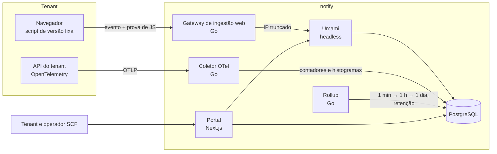

# notify

Plataforma open source e multi-tenant de **analytics web e de API** para projetos do ecossistema [Stellar](https://stellar.org), proposta para o RFP *Web and API Analytics for Stellar Ecosystem Projects* do [Stellar Community Fund](https://communityfund.stellar.org) (SCF).

> **Estado:** o código do MVP está implementado e testado no CI: portal, script de rastreamento, gateway web, coletor de API, consolidação das métricas, painéis do tenant e do SCF e a infraestrutura de produção como código. **Nenhuma produção real foi aplicada ainda** e não há pilotos; o que falta está em [`docs/andamento.md`](docs/andamento.md).

## O problema

O SCF não tem uma fonte confiável e unificada de dados de uso dos projetos que financia. Hoje os revisores dependem de números informados pelos próprios projetos para decidir quem entra em programas de continuidade.

O notify oferece uma plataforma compartilhada e gratuita em que:

- cada projeto (tenant) mede o uso do seu site e da sua API e vê só os próprios dados;
- operadores do SCF veem e comparam as métricas de todos os projetos.

## O que a plataforma mede

**Web**, coletando só no frontend, sem cookies e sem dado pessoal:

- visualizações de página e visitantes únicos;
- referenciadores;
- duração da sessão e taxa de rejeição;
- país, dispositivo e navegador;
- eventos customizados opcionais (`window.notify.event`), sem endereço de carteira, hash ou valor.

**API**, a partir do OpenTelemetry que o projeto já envia ao próprio APM (dual-export):

- volume de requisições por endpoint normalizado;
- distribuição de status code;
- latência p50 e p95.

O coletor descarta traces, spans e logs e guarda só contadores e histogramas.

## Arquitetura



| Componente | Stack | Papel |
|---|---|---|
| Portal | Next.js | Cadastro self-service, painéis do tenant e painéis globais do SCF |
| Script de rastreamento | TypeScript | Versão fixa e imutável (`/s/vX.Y.Z/n.js`), com SRI e nome que ad blockers não bloqueiam |
| Gateway de ingestão web | Go | Anti-bot (prova de execução de JS, limite de fingerprints por IP) e truncamento do IP |
| [Umami](https://umami.is) v3.4.1 | Next.js | Motor de analytics web, usado sem fork |
| Coletor de API | OpenTelemetry Collector + componentes Go | Autenticação por chave, normalização de rotas e gravação das métricas |
| Rollup | Go | Consolida as métricas de API de 1 minuto em 1 hora e 1 dia e aplica a retenção |
| Banco | PostgreSQL 17 | Bancos separados `umami` (analytics web) e `notify` (tenants, chaves e métricas de API, com 24 meses de agregados) |
| Infra | OpenTofu, Ansible, Docker Compose, Caddy | Hospedagem na União Europeia (Hetzner), backup contínuo cifrado, recriável a partir deste repositório |

Em produção, o Caddy é a única porta de entrada, com três hosts na 443: portal, ingestão web e ingestão de API (OTLP por HTTP e gRPC). O Umami nunca é exposto.

A visão completa, com os dois fluxos, está em [`docs/arquitetura.md`](docs/arquitetura.md). As decisões e as alternativas descartadas estão nos ADRs ([índice](docs/adr/README.md)); os de base são:

- [0001 — Umami como ferramenta base](docs/adr/0001-ferramenta-base.md)
- [0002 — Arquitetura e stack](docs/adr/0002-arquitetura-e-stack.md)
- [0003 — Isolamento entre tenants é responsabilidade do portal](docs/adr/0003-isolamento-no-portal.md)
- [0004 — Hospedagem na Hetzner, OpenTofu e backup com WAL-G](docs/adr/0004-hospedagem-e-backup.md)

## Documentação

| Para | Leia |
|---|---|
| Integrar um projeto (script, dual-export, painéis) | [`docs/onboarding-de-tenant.md`](docs/onboarding-de-tenant.md) e [`examples/`](examples/README.md) |
| Subir e operar uma instância | [`docs/deploy.md`](docs/deploy.md) e os [runbooks](docs/runbooks/README.md) |
| Privacidade e dados coletados | [`docs/privacidade.md`](docs/privacidade.md) |
| Anti-bot e cadeia de suprimentos | [`docs/anti-bot-e-cadeia-de-suprimentos.md`](docs/anti-bot-e-cadeia-de-suprimentos.md) |
| Disponibilidade e limites atuais | [`docs/sla.md`](docs/sla.md) e o [relatório de carga](docs/relatorios/carga-1m-dia.md) |
| Andamento e pendências | [`docs/andamento.md`](docs/andamento.md) |

## Estrutura do repositório

```
apps/
  portal/            Portal Next.js: cadastro, painéis do tenant e do SCF
packages/
  tracker/           Script de rastreamento (TypeScript, esbuild)
services/            Módulo Go único (go.mod)
  ingest-web/        Gateway de ingestão web
  collector/         Coletor OpenTelemetry (manifesto do OCB)
    components/      Autenticação por chave, normalização de rotas, exporter Postgres
  rollup/            Consolidação e retenção das métricas de API
  loadtest/          Ferramenta de carga (web e API)
infra/               OpenTofu, Ansible, Docker Compose, Caddy e monitoramento
examples/            Integrações de referência (HTML, SPA, SSR, backend com OTel)
docs/                ADRs, specs, guias, runbooks e registro de andamento
```

Cada pasta tem um `README.md` com o papel dela.

- **TypeScript:** pnpm workspaces (`apps/*`, `packages/*`, `examples/*`) e Turborepo. O pnpm só instala versões publicadas há pelo menos 14 dias (`minimumReleaseAge` no `pnpm-workspace.yaml`).
- **Go:** um módulo só, em `services/`.

### Requisitos e comandos

Node.js 24 ou mais novo, pnpm 10 (ative com `corepack enable`) e Go 1.26.

```bash
pnpm install
pnpm build      # turbo run build
pnpm lint
pnpm test
```

Os testes de integração precisam do Postgres do ambiente local (abaixo) em `DATABASE_URL`. Para o Go, rode de dentro de `services/`: `go vet -tags e2e ./...` e `go test -race ./...`.

### Ambiente local (Docker Compose)

Requer Docker com o Compose v2. Na raiz do repositório:

```bash
docker compose up -d --wait
```

A primeira subida cria os bancos `umami` e `notify`, aplica as migrações do Umami e do portal e constrói as imagens do portal, do gateway, do coletor e do rollup, sem passo manual. O build exige o BuildKit (plugin `buildx` do Docker).

| Serviço | Endereço | Acesso |
|---|---|---|
| Portal | http://localhost:3000 | crie um usuário com `pnpm user:create` (ver [`apps/portal`](apps/portal/README.md#criar-um-usuário)) |
| Umami v3.4.1 | só na rede interna (`http://umami:3000`); http://127.0.0.1:3001 com o override abaixo | usuário `admin`, senha `umami` (padrão do Umami; só local) |
| Gateway de ingestão web | http://localhost:3002 | `POST /e`, `GET /c`, `GET /s/` e `GET /healthz` |
| Coletor de API | `localhost:4317` (gRPC) e http://localhost:4318 (HTTP) | OTLP com `Authorization: Bearer ntf_...` (chave criada em `/services`) |
| Mailpit | http://localhost:8025 | caixa de entrada dos e-mails do portal (confirmação e redefinição de senha) |
| PostgreSQL 17 | `localhost:5432` | `postgres`/`postgres` (superusuário), `umami`/`umami` e `notify`/`notify`, cada um dono do seu banco |

- Para mudar portas ou senhas, copie `.env.example` para `.env` e edite.
- O Umami não publica porta ([#62](https://github.com/romulospl/notify/issues/62), [docs/umami.md](docs/umami.md)). Para usar a interface dele, o script da conta de serviço ou o teste ponta a ponta do gateway, inclua o override de desenvolvimento: `docker compose -f compose.yaml -f infra/compose/umami-port.yaml up -d --wait` (ou `COMPOSE_FILE=compose.yaml:infra/compose/umami-port.yaml` no `.env`).
- `docker compose down` para os serviços e mantém os dados. `docker compose down -v` apaga o volume, e a próxima subida recria os bancos do zero.
- Os arquivos ficam em [`infra/compose/`](infra/compose/): `dev.yaml` é o ambiente local e `prod.yaml` a produção.
- Os três exemplos de integração e o backend com OTel estão em [`examples/`](examples/README.md).

### Integração contínua

O workflow [`ci.yml`](.github/workflows/ci.yml) roda em todo push na `main` e em todo PR:

| Job | O que faz |
|---|---|
| `typescript` | `pnpm install --frozen-lockfile` (falha se o lockfile estiver desatualizado), `lint`, `typecheck`, `test` e `build`, com Postgres disponível em `DATABASE_URL` |
| `go` | `gofmt`, `go mod tidy -diff`, `go vet` e `go test -race` em `services/`, também com Postgres |
| `compose` | Sobe o ambiente local com `docker compose` e roda os testes ponta a ponta: exemplos num Chromium, gateway, privacidade (IP completo em lugar nenhum) e pipeline de API |
| `infra` | Valida OpenTofu, Ansible e Caddyfile e sobe a pilha de produção com um S3 local: rotas do Caddy, portas, ingestão de API pelo host público, backup cifrado, restauração e replicação |
| `monitoring` | Sobe o monitoramento externo e confere o alerta por e-mail quando um alvo cai e o de resolvido quando volta |
| `ci` | Agrega os anteriores em um resultado só. A `main` não tem proteção de branch, então o check não bloqueia merge; se a proteção for ligada, é este o check a exigir |

As actions são fixadas por SHA, com a tag em comentário.

Fora do agregador, porque dependem de dados externos que mudam sem mudança no código: [`adblock.yml`](.github/workflows/adblock.yml) confere todo dia que as listas de bloqueio não barram o script nem os endpoints, e [`dependencies.yml`](.github/workflows/dependencies.yml) roda `govulncheck`, `pnpm audit` e a conferência de licenças (só aprovadas pela OSI).

### Cadeia de suprimentos

- **Dependências travadas:** `pnpm-lock.yaml` e `services/go.sum` commitados; o CI falha com lockfile ausente ou desatualizado.
- **Espera de 14 dias:** o pnpm recusa versões mais novas (`minimumReleaseAge`) e o [Renovate](renovate.json) só abre PR para releases com pelo menos 14 dias. O Umami nunca é atualizado em grupo nem automaticamente. Versões maiores só viram PR depois de aprovadas no Dependency Dashboard (um issue mantido pelo Renovate); correções de segurança passam direto.
- **Release:** ao publicar uma release no GitHub (tag `vX.Y.Z`), o workflow [`release.yml`](.github/workflows/release.yml) anexa um SBOM (SPDX, gerado com syft) e, para cada `Dockerfile` em `apps/*` e `services/*`, publica a imagem em `ghcr.io/romulospl/notify/<nome>`, assinada com cosign (keyless) e com o SBOM da imagem como atestado.

Para verificar uma imagem publicada:

```bash
cosign verify ghcr.io/romulospl/notify/<nome>:<versão> \
  --certificate-identity-regexp '^https://github.com/romulospl/notify/\.github/workflows/release\.yml@refs/tags/v' \
  --certificate-oidc-issuer https://token.actions.githubusercontent.com
```

Para conferir o SBOM atestado, troque `verify` por `verify-attestation --type spdxjson` no mesmo comando.

## Produção

A produção é uma VM na Hetzner (UE), descrita por inteiro em [`infra/`](infra/README.md): OpenTofu para a VM, o firewall e o bucket de backup, Ansible para a configuração e [`infra/compose/prod.yaml`](infra/compose/prod.yaml) para os serviços. O deploy só aceita imagens por digest e com a assinatura conferida. O passo a passo, a restauração do banco e o que ainda não foi testado numa conta real estão em [`docs/deploy.md`](docs/deploy.md).

## Privacidade

A meta é conformidade com a GDPR **sem banner de consentimento**:

- **IP:** o último octeto do IPv4 é descartado (no IPv6 fica só o /48) antes da geolocalização. O IP completo nunca é gravado, nem em log.
- **Navegador:** nenhum cookie, `localStorage` ou identificador persistente.
- **Umami:** gravação de sessão e heatmaps ficam desligados.
- **API:** traces, spans e logs são descartados no coletor; ficam só contadores e histogramas por rota normalizada.
- **Dados:** ficam armazenados na União Europeia.

O detalhe, com retenção e lacunas conhecidas, está em [`docs/privacidade.md`](docs/privacidade.md).

## Roadmap

O código de E1 a E6 está implementado; os guias do E7 estão escritos, à espera de teste por alguém de fora; o E8 (pilotos) não começou e o E9 está parcial. O backlog está nas [issues](https://github.com/romulospl/notify/issues), organizado em épicos, e no [quadro do projeto](https://github.com/users/romulospl/projects/1).

| Épico | Escopo |
|---|---|
| [E1](https://github.com/romulospl/notify/issues/1) | Fundação do monorepo e infraestrutura |
| [E2](https://github.com/romulospl/notify/issues/2) | Multi-tenant, cadastro e controle de acesso |
| [E3](https://github.com/romulospl/notify/issues/3) | Coleta de analytics web |
| [E4](https://github.com/romulospl/notify/issues/4) | Painéis de analytics web |
| [E5](https://github.com/romulospl/notify/issues/5) | Pipeline de analytics de API (OpenTelemetry) |
| [E6](https://github.com/romulospl/notify/issues/6) | Painéis de analytics de API |
| [E7](https://github.com/romulospl/notify/issues/7) | Documentação, privacidade e conformidade |
| [E8](https://github.com/romulospl/notify/issues/8) | Pilotos com projetos reais do SCF |
| [E9](https://github.com/romulospl/notify/issues/9) | Pós-MVP: SLA, escala, chaves de API e transferência |
| [E10](https://github.com/romulospl/notify/issues/63) | Proposta e submissão ao SCF |

## Contribuindo

O guia completo está no [`CONTRIBUTING.md`](CONTRIBUTING.md), e vulnerabilidades são relatadas como descrito no [`SECURITY.md`](SECURITY.md). Dúvidas e bugs vão para as [issues](https://github.com/romulospl/notify/issues/new/choose), que são o canal público de suporte.

- Commits seguem o [Conventional Commits 1.0.0-beta.4](https://www.conventionalcommits.org/pt-br/v1.0.0-beta.4/), por exemplo `feat(collector): add Stellar address normalization`.
- Decisões de arquitetura novas viram um ADR em [`docs/adr/`](docs/adr/README.md), a partir do [template](docs/adr/template.md).

## Licença

[MIT](LICENSE).
