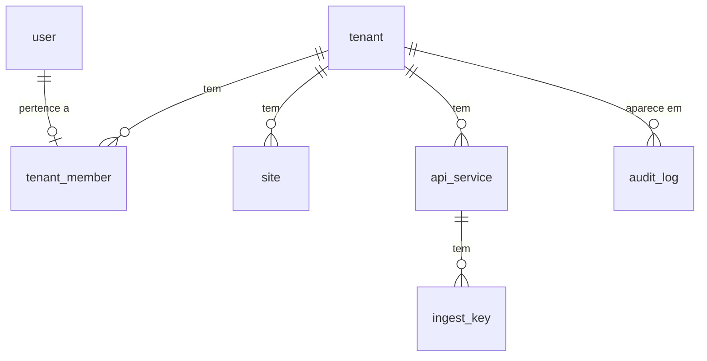

# Spec E2: tenants e controle de acesso

- **Status:** Aceito
- **Data:** 13/11/2026
- **Épico:** [#2 (E2)](https://github.com/romulospl/notify/issues/2)
- **Issues cobertas:** #16, #58, #59, #60, #17, #18, #19, #20 e #21
- **Depende de:** [ADR 0003](../adr/0003-isolamento-no-portal.md)
- **Implementação:** [o que foi feito no E2](../e2-implementacao.md)

Este documento fixa o contrato que as issues do E2 precisam respeitar: o modelo de dados do banco `notify`, os papéis, a regra de isolamento, a chave de ingestão e o que cada status de tenant bloqueia. Decisão com alternativas descartadas fica em ADR; aqui fica só o contrato escolhido.

As seis decisões marcadas com **D1** a **D6** foram confirmadas em 13/11/2026. Elas estão reunidas na [seção 9](#9-decisões-tomadas), com a alternativa descartada de cada uma.

## 1. Ponto de partida

O que a #57 já deixou no código:

- tabelas do Better Auth (`user`, `session`, `account`, `verification`) no banco `notify`;
- coluna `user.role` com os valores `tenant` e `operator`, que o cliente não consegue definir;
- `requireSession()` e `requireOperator()` em `apps/portal/src/lib/session.ts`, sempre no servidor;
- cadastro desligado (`disableSignUp: true`); contas criadas pelo script `scripts/create-user.mjs`;
- o IP de quem entra no portal não é gravado.

## 2. Papéis

| Papel | Onde fica | O que é |
|---|---|---|
| Membro de tenant | `user.role = 'tenant'` mais uma linha em `tenant_member` | Pessoa de um projeto. Vê e administra só o próprio projeto |
| Operador SCF | `user.role = 'operator'` | Pessoa indicada pelo SCF. Lê todos os projetos e pode remover ou reativar um projeto |
| Administrador | Não é papel no banco | Quem tem acesso ao servidor. Cria e remove operadores por comando |

Regras:

- **D1.** Cada usuário pertence a **um único tenant**. A tabela `tenant_member` já tem o formato de muitos-para-muitos, com um índice único em `user_id` que pode ser retirado no futuro sem mudar o resto.
- **D2.** Um operador **não é membro de tenant**. Quem é do SCF e também tem um projeto usa duas contas. Isso mantém o papel global simples e separa as duas funções.
- **D3.** Não existe papel de administrador no portal. Operador só nasce pelo script de administração, e a promoção fica registrada em `audit_log`.
- Dentro do tenant há dois níveis: `owner` (quem criou o projeto) e `member`. No MVP os dois podem o mesmo; a diferença só passa a valer quando houver convite de membros (fora deste spec, ver [seção 10](#10-fora-do-escopo)).

### Matriz de permissões

| Ação | Membro | Operador | Sem sessão |
|---|---|---|---|
| Ver painéis web e de API do próprio tenant | Sim | — | Não |
| Cadastrar site e serviço de API no próprio tenant | Sim | Não | Não |
| Criar, listar e revogar chaves de ingestão do próprio tenant | Sim | Não | Não |
| Ver dados de outro tenant | Não (404) | Sim, só leitura | Não |
| Ver painéis globais e comparativos | Não (404) | Sim | Não |
| Remover ou reativar um tenant | Não | Sim | Não |
| Ver chaves de ingestão de qualquer tenant | Não | Não (só prefixo e datas) | Não |
| Criar operador | Não | Não | Não |

Recurso de outro tenant responde **404**, não 403, para não revelar que o recurso existe. É o mesmo critério que `requireOperator()` já usa.

## 3. Modelo de dados

Tudo no banco `notify`, com migrações do Drizzle. Identificadores novos são `uuid` gerados pelo banco; `user.id` continua `text`, como o Better Auth cria.

### `tenant`

| Coluna | Tipo | Observação |
|---|---|---|
| `id` | `uuid` PK | É o `tenant.id` das métricas de API |
| `name` | `text` | Nome do projeto |
| `slug` | `text` único | Gerado do nome; usado nas telas do operador |
| `status` | enum `tenant_status` | `active`, `removed`, `pending`. Padrão `active` |
| `status_changed_at` | `timestamptz` | |
| `status_changed_by` | `text` FK `user.id` | Operador que mudou o status |
| `status_reason` | `text` | Motivo informado pelo operador |
| `created_at`, `updated_at` | `timestamptz` | |

### `tenant_member`

| Coluna | Tipo | Observação |
|---|---|---|
| `tenant_id` | `uuid` FK | PK composta com `user_id` |
| `user_id` | `text` FK `user.id` | Índice único (D1) |
| `role` | enum `member_role` | `owner`, `member` |
| `created_at` | `timestamptz` | |

### `site`

| Coluna | Tipo | Observação |
|---|---|---|
| `id` | `uuid` PK | |
| `tenant_id` | `uuid` FK | |
| `name` | `text` | |
| `domain` | `text` | Único por tenant |
| `umami_website_id` | `uuid` único | ID do site no Umami. É o que o script de rastreamento envia |
| `created_at`, `archived_at` | `timestamptz` | Site arquivado para de receber eventos e some dos painéis |

### `api_service`

| Coluna | Tipo | Observação |
|---|---|---|
| `id` | `uuid` PK | |
| `tenant_id` | `uuid` FK | |
| `name` | `text` | Único por tenant. É o nome do serviço mostrado nos painéis |
| `created_at`, `archived_at` | `timestamptz` | |

### `ingest_key`

| Coluna | Tipo | Observação |
|---|---|---|
| `id` | `uuid` PK | |
| `api_service_id` | `uuid` FK | |
| `tenant_id` | `uuid` FK | Repetido aqui para o coletor resolver o tenant sem junção |
| `prefix` | `text` único | Parte pública da chave, mostrada nas telas |
| `key_hash` | `bytea` | SHA-256 da chave completa |
| `created_by` | `text` FK `user.id` | |
| `created_at`, `revoked_at` | `timestamptz` | |
| `last_used_on` | `date` | Atualizado no máximo uma vez por dia |

### `audit_log`

| Coluna | Tipo | Observação |
|---|---|---|
| `id` | `uuid` PK | |
| `at` | `timestamptz` | |
| `actor_user_id` | `text` | Nulo quando a ação vem do script de administração |
| `action` | `text` | Ex.: `tenant.removed`, `tenant.reactivated`, `operator.created`, `ingest_key.created`, `ingest_key.revoked` |
| `tenant_id` | `uuid` | Nulo em ações globais |
| `details` | `jsonb` | Nunca contém chave, senha nem IP |

Só recebe inserções. Atende ao critério da #20 ("remoção registrada: quem, quando").

## 4. Regra de isolamento

O princípio, decidido no ADR 0003: **o tenant vem sempre da sessão, nunca de um valor enviado pelo cliente**.

### Contexto de acesso

Dois tipos, criados só por funções do servidor em `apps/portal/src/lib/access.ts`:

| Função | Devolve | Falha |
|---|---|---|
| `requireTenantContext()` | `TenantContext { userId, tenantId, memberRole, tenantStatus }` | Sem sessão: vai para o login. Operador ou usuário sem tenant: 404 |
| `requireOperatorContext()` | `OperatorContext { userId }` | Quem não é operador: 404 |

Os dois tipos são marcados (*branded*), de modo que nenhum outro código consegue montar um contexto à mão.

### Camada única de dados

- Todo acesso ao banco fica em `apps/portal/src/lib/data/`. Toda função exportada recebe um contexto como primeiro argumento e filtra por `ctx.tenantId`.
- Todo acesso ao Umami fica em `apps/portal/src/lib/umami/`. As funções de leitura recebem um `TenantContext` e o `site.id` do portal; a função resolve o `umami_website_id` conferindo que o site é do tenant do contexto. Nenhuma função pública aceita o ID do Umami direto.
- Uma regra do ESLint (`no-restricted-imports`) proíbe importar o cliente do banco e o cliente HTTP do Umami fora dessas duas pastas. Assim, esquecer o filtro vira erro de lint, não bug em produção.
- As funções do operador ficam em arquivos separados (`lib/data/operator/`), recebem `OperatorContext` e são somente leitura, com exceção de remover e reativar tenant.

### Rotas

- As rotas do tenant **não têm o ID do tenant na URL** (`/dashboard`, `/sites/[siteId]`, `/services/[serviceId]`).
- IDs de recurso na URL (`siteId`, `serviceId`, `keyId`) são sempre conferidos contra o contexto. Recurso de outro tenant responde 404.
- As rotas do operador ficam sob `/operator` e são as únicas que aceitam um `tenantId` na URL.

### Papéis no Postgres

**D4.** Cada serviço usa um usuário próprio do banco `notify`, com o mínimo de permissão:

| Usuário | Quem usa | Permissão |
|---|---|---|
| `notify` | Portal | Dono das tabelas |
| `notify_ingest` | Gateway web (#61) | `SELECT` na visão `ingest_site` (ID do site no Umami e se aceita ingestão) |
| `notify_collector` | Coletor (#30) | `SELECT` na visão `ingest_key_active`; `INSERT` nas tabelas de métricas |

Assim, uma falha no gateway ou no coletor não dá acesso a e-mails, sessões nem hashes de senha.

## 5. Chave de ingestão

Contrato entre o portal (#59) e o coletor (#30).

- **Formato:** `ntf_<prefixo>_<segredo>`.
  - `prefixo`: 8 caracteres aleatórios em base32 minúsculo. É público e identifica a chave nas telas e nos logs.
  - `segredo`: 32 bytes aleatórios do gerador criptográfico do sistema, em base64url (43 caracteres).
- **Armazenamento:** o banco guarda o `prefix` e o SHA-256 da chave completa. Como o segredo tem 256 bits de entropia, um hash rápido é suficiente e permite ao coletor validar sem custo.
- **Exibição:** a chave completa aparece uma única vez, na resposta da criação. Depois disso só o prefixo.
- **Envio:** no header `Authorization: Bearer <chave>` do OTLP, em HTTP e em gRPC.
- **Validação no coletor:** busca pelo prefixo, compara o hash em tempo constante e confere que a chave não foi revogada, que o serviço não está arquivado e que o tenant está `active`.
- **Cache:** o coletor guarda o resultado por no máximo 60 segundos. Com isso, uma revogação ou a remoção do tenant vale em até 1 minuto (critério da #59).
- **Limite:** até 5 chaves ativas por serviço, o que permite trocar de chave sem parar a ingestão.
- **O que a chave define:** o tenant **e** o serviço. O `tenant.id` das métricas vem sempre da chave. **D5.** O serviço também vem da chave: o `service.name` enviado pelo cliente é ignorado, para um cliente não inflar o número de serviços. O detalhe fica para o spec do E5.
- **Logs:** a chave completa nunca é registrada. Em log aparece só o prefixo.

## 6. Status do tenant

| Status | Entrar no portal | Painéis do tenant | Cadastrar site, serviço e chave | Ingestão web e de API | Painéis globais do SCF |
|---|---|---|---|---|---|
| `active` | Sim | Sim | Sim | Aceita | Aparece |
| `removed` | Sim | Só um aviso de projeto removido, com o motivo | Não | Recusada | Não aparece nas comparações; operador ainda consegue abrir |
| `pending` (não usado no MVP) | Sim | Sim, vazios | Sim | Recusada | Não aparece |

- **Remoção é desativação.** Os dados já coletados ficam no banco. Apagar dados de um tenant removido é uma ação separada, fora deste spec.
- **D6.** O operador pode **reativar** um tenant removido. A ação vai para o `audit_log`.
- **Como a ingestão fica sabendo:** o gateway e o coletor consultam as visões da seção 4 e guardam o resultado por no máximo 60 segundos.
- **Resposta ao recusar:** o gateway responde como se tivesse aceitado (para não dar pista a quem testa IDs) e descarta o evento. O coletor responde `401` (OTLP HTTP) ou `Unauthenticated` (gRPC), porque o dono do serviço precisa saber que a chave não vale mais.

## 7. Cadastro e provisionamento

### Cadastro self-service (#17 e #60)

1. A pessoa informa nome, e-mail e senha (mínimo de 12 caracteres, já configurado).
2. O portal envia um link de confirmação. Sem confirmar o e-mail, não cria projeto.
3. Com o e-mail confirmado, informa o nome do projeto. O portal cria o `tenant` com status `active` e a linha em `tenant_member` com `owner`, na mesma transação.
4. Cadastra sites e serviços de API. Ao criar um serviço, recebe a primeira chave de ingestão.

Quando o cadastro com aprovação for ligado (#49), o passo 3 passa a criar o tenant como `pending`; nada mais muda.

### Site no Umami (#58)

- Cada `site` do portal corresponde a **um site no Umami**, criado pela conta de serviço.
- O portal **não cria usuários nem equipes no Umami**. Ninguém entra no Umami: ele fica só na rede interna (#62) e o isolamento é do portal (ADR 0003).
- Ordem ao criar: primeiro o site no Umami, depois a linha em `site`. Se a gravação falhar, o portal apaga o site recém-criado no Umami.
- Um teste de consistência confere que todo `umami_website_id` existe no Umami e que não há site no Umami sem linha em `site`.
- A conta de serviço é um usuário comum do Umami (papel `user`), autenticado por chave de API em `UMAMI_API_KEY`. Confirmado na #58 e registrado no ADR 0001.

## 8. Testes de isolamento (#21)

A suíte cria dois tenants (A e B), cada um com site, serviço e chave, e um operador. Casos mínimos:

| Caso | Resultado esperado |
|---|---|
| Membro de A abre um site, serviço ou chave de B pela URL | 404 |
| Membro de A chama uma rota de API do portal com ID de B | 404 |
| Membro de A abre `/operator` | 404 |
| Membro de A tenta mudar o próprio papel pelo cliente | Ignorado |
| Operador lê dados de A e de B | Permitido |
| Operador tenta criar site ou chave em A | Recusado |
| Chave de A envia métricas dizendo ser do tenant B | Gravadas como A |
| Chave revogada de A | Recusada em até 60 segundos |
| Tenant B removido: evento web e métrica de API de B | Descartados |
| Usuário sem tenant abre `/dashboard` | Vai para a criação de projeto |
| Leitura do Umami com `umami_website_id` de B a partir do contexto de A | Recusada antes de chegar ao Umami |

Cada painel novo (#28 e #37) acrescenta os próprios casos a esta suíte.

## 9. Decisões tomadas

| Nº | Decisão | Alternativa descartada | Efeito se mudar |
|---|---|---|---|
| D1 | Um usuário pertence a um único tenant | Vários tenants por usuário, com troca de projeto ativo | A sessão passa a guardar o tenant ativo e toda tela ganha o seletor |
| D2 | Operador não é membro de tenant | Papel global separado do papel no tenant | `requireTenantContext()` precisa aceitar operador com projeto |
| D3 | Sem papel de administrador; operador criado por script | Tela de administração no portal | Mais uma área para proteger e testar |
| D4 | Um usuário de banco por serviço, com visões só de leitura | Todos usam o usuário `notify` | Mais simples, mas uma falha na ingestão expõe as contas |
| D5 | O serviço vem da chave; `service.name` do cliente é ignorado | Aceitar o `service.name` do cliente | Exige limite de cardinalidade por tenant no coletor |
| D6 | Operador pode reativar tenant removido | Remoção definitiva | O projeto removido por engano precisa se cadastrar de novo |

## 10. Fora do escopo

- **Convite de membros.** O modelo aceita vários usuários por tenant, mas não há issue para o fluxo de convite. Hoje só quem cria o projeto tem acesso. Se for necessário para os pilotos, criar a issue.
- **Exclusão da própria conta e do projeto pelo tenant.** O e-mail do membro é dado pessoal, então o documento de privacidade (#40) precisa prever como a pessoa pede a exclusão.
- **Apagar os dados de um tenant removido.**
- **Chaves de API do SCF para leitura das métricas** (#48, decidido no [ADR 0006](../adr/0006-api-de-leitura-do-scf.md)) e **cadastro com aprovação** (#49), que são pós-MVP. O modelo já prevê o status `pending`.
- **Esquema das métricas de API**, que fica no spec do E5.

## 11. Efeito nas issues

| Issue | O que o spec define para ela |
|---|---|
| #16 | Tabelas `tenant`, `tenant_member`, `site`, `api_service`, `ingest_key` e `audit_log` (seção 3) |
| #58 | Um site no Umami por `site`, sem usuários nem equipes (seção 7) |
| #59 | Formato, hash, limite e revogação da chave (seção 5) |
| #60 e #17 | Fluxo de cadastro (seção 7) |
| #18 | Contexto de acesso, camada única e regra de lint (seção 4) |
| #19 | Papéis e matriz de permissões (seção 2) |
| #20 | Status e recusa da ingestão (seção 6) |
| #21 | Casos mínimos (seção 8) |
| #12, #61 e #30 | Pela D4, o script de criação dos bancos ganha os usuários `notify_ingest` e `notify_collector`. A mudança no script entra na #16, junto com as visões |
