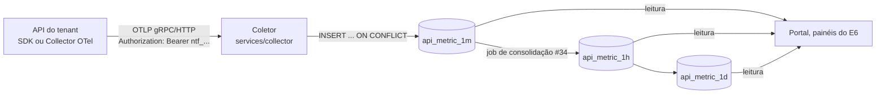

# Spec E5: pipeline de analytics de API

- **Status:** Aceito
- **Data:** 14/11/2026
- **Épico:** [#5 (E5)](https://github.com/romulospl/notify/issues/5)
- **Issues cobertas:** #30, #31, #32, #33, #34, #35 e #36
- **Depende de:** [ADR 0002](../adr/0002-arquitetura-e-stack.md) e [spec do E2](e2-tenants-e-controle-de-acesso.md) (seção 5, chave de ingestão; seção 6, status do tenant)

Este documento fixa o contrato entre o coletor (`services/collector`), o banco `notify` e os painéis de API (E6). Ele cobre o que entra no coletor, o que sai dele, as regras de normalização de rotas, as tabelas de métricas e a retenção. As decisões marcadas com **D1** a **D8** foram confirmadas em 14/11/2026 e estão reunidas na [seção 8](#8-decisões-tomadas).

## 1. Fluxo

1. O tenant manda o mesmo OTLP que já manda para o próprio APM (dual-export, #35).
2. O coletor valida a chave (spec do E2, seção 5). A chave define o **tenant e o serviço**; nenhum atributo do cliente muda isso.
3. O coletor transforma spans de servidor HTTP e a métrica `http.server.request.duration` em contagem e histograma (#31), normaliza a rota (#32) e descarta todo o resto.
4. A cada lote, grava baldes de 1 minuto em `api_metric_1m` (#33).
5. Um job consolida 1 minuto em 1 hora e 1 dia e aplica a retenção (#34).

## 2. O que o coletor aceita

| Entrada | O que vira | Observação |
|---|---|---|
| Span com `span.kind = SERVER` e `http.request.method` | Uma requisição | A duração é `end - start`. O balde de tempo é o minuto do fim do span (D6) |
| Métrica `http.server.request.duration` (histograma) | As requisições já contadas | Os buckets são somados aos nossos, desde que os limites batam com os da seção 4. Se não baterem, cada bucket de origem cai no nosso bucket que contém o limite superior dele |
| Qualquer outro span, métrica ou log | Nada | Descartado no coletor. Nunca é gravado |

Atributos lidos do span ou do ponto de métrica: `http.route`, `url.path` (ou `http.target`, nas convenções antigas), `http.request.method` (ou `http.method`) e `http.response.status_code` (ou `http.status_code`). Os demais, incluindo `service.name` (D5 do E2), IDs de usuário, `url.query`, IP e User-Agent, são ignorados.

Métodos fora da lista padrão do HTTP (`GET`, `HEAD`, `POST`, `PUT`, `DELETE`, `CONNECT`, `OPTIONS`, `TRACE`, `PATCH`) viram `_OTHER`, como pedem as convenções do OpenTelemetry. Sem status, grava `0`.

## 3. Normalização de rotas (#32)

O objetivo é que `/accounts/GABC.../payments/` e `/accounts/GXYZ.../payments` contem como a mesma rota, `/accounts/{address}/payments`, sem estourar a cardinalidade.

1. **Se o cliente mandou `http.route`, ela vale** (é o template do framework, como `/users/:id`). Só passa pela regra de tamanho do passo 4.
2. Senão, parte de `url.path` (ou `http.target`) sem query string nem fragmento. Uma URL completa vira só o caminho.
3. Cada segmento entre barras é trocado pelo primeiro marcador que casar, nesta ordem:

| Marcador | Segmento que casa | Exemplo |
|---|---|---|
| `{uuid}` | UUID 8-4-4-4-12 em hexadecimal, sem diferença entre maiúsculas e minúsculas | `3f2c...-...` |
| `{address}` | Endereço Stellar em StrKey: `G` ou `C` com 56 caracteres ou `M` com 69, todos em base32 maiúsculo (`A-Z2-7`) | `GABC...`, `CDEF...`, `MAAA...` |
| `{hash}` | Hexadecimal com 16 caracteres ou mais, com ou sem `0x` (hash de transação, de ledger ou de bloco) | `a1b2c3...` |
| `{id}` | Só dígitos | `42`, `1700000000` |

4. A barra final é removida (exceto na raiz `/`), barras repetidas viram uma só, e o caminho vazio vira `/`. Rota com mais de 256 bytes é cortada em 256.
5. Os marcadores ficam fixos no código, como pede o RFP. Não há regra configurável por tenant no MVP.

A regra do `{address}` confere só o formato (prefixo, tamanho e alfabeto), não o checksum da StrKey: um segmento de 56 letras maiúsculas desse alfabeto começando com `G` é, na prática, sempre um endereço.

**Teto de cardinalidade (D4):** cada serviço guarda no máximo 500 rotas distintas por dia. A partir da 501ª, as rotas novas do dia são gravadas como `{other}`. O teto fica no coletor (#31) e protege o banco de um cliente que mande caminhos únicos (busca livre no caminho, por exemplo).

## 4. Tabelas de métricas (#33)

Tudo no banco `notify`, em migração escrita à mão no portal (`apps/portal/drizzle/`, como a `0002_ingest_views.sql`). O portal é o único dono das migrações do banco (D5).

### `api_metric_1m`, `api_metric_1h` e `api_metric_1d`

As três têm as mesmas colunas e diferem só no tamanho do balde.

| Coluna | Tipo | Observação |
|---|---|---|
| `bucket_start` | `timestamptz` | Início do balde (minuto, hora ou dia, em UTC) |
| `tenant_id` | `uuid` | Da chave de ingestão |
| `api_service_id` | `uuid` | Da chave de ingestão |
| `route` | `text` | Rota normalizada (seção 3) |
| `method` | `text` | Método HTTP ou `_OTHER` (D1) |
| `status_code` | `smallint` | `0` quando não veio |
| `request_count` | `bigint` | Número de requisições |
| `duration_sum` | `double precision` | Soma das durações, em segundos |
| `duration_buckets` | `bigint[]` | Contagem por bucket de duração (D2) |

- **Chave primária:** `(tenant_id, api_service_id, route, method, status_code, bucket_start)`. O coletor grava com `INSERT ... ON CONFLICT DO UPDATE`, somando contagem, soma e buckets.
- **Particionamento (D5):** por intervalo de `bucket_start`, uma partição por mês, mais uma partição `default` para nunca recusar um ponto. A função `api_metric_ensure_partitions(meses)` cria as partições do mês corrente e dos seguintes; o job da #34 a chama todo dia. A migração já cria as do mês corrente e dos dois seguintes.
- **Índice para os painéis:** `(tenant_id, bucket_start)`, que atende "o período X do tenant" filtrando por serviço e rota. A chave primária já atende a busca por série.
- **Chaves estrangeiras:** nenhuma. Em tabela particionada e com volume alto, a integridade vem da chave de ingestão, que só existe para serviço válido.

### Buckets de duração (D2)

Limites superiores em segundos, iguais à recomendação das convenções do OpenTelemetry para `http.server.request.duration`, para que histogramas prontos entrem sem conversão:

`0.005, 0.01, 0.025, 0.05, 0.075, 0.1, 0.25, 0.5, 0.75, 1, 2.5, 5, 7.5, 10` e um último bucket acima de 10 s. São 15 posições em `duration_buckets`; a posição `i` conta as durações em `(limite[i-1], limite[i]]`.

### Percentis

O agregado `api_metric_sum_buckets(duration_buckets)` soma os arrays por posição (a função `api_metric_add_buckets(a, b)` faz o mesmo para dois arrays, no `ON CONFLICT` do coletor), e `api_metric_bounds()` devolve os limites. A função `api_metric_quantile(buckets bigint[], q double precision)` devolve o percentil `q` (0 a 1), interpolando linearmente dentro do bucket onde ele cai. Quando ele cai no último bucket (acima de 10 s), devolve 10. Para um período, os painéis somam os arrays por posição e aplicam a função sobre a soma. O erro é de no máximo a largura do bucket, o que basta para p50 e p95 de API.

### Permissões

| Usuário | Permissão |
|---|---|
| `notify_collector` | `SELECT` em `ingest_key_active` (E2); `SELECT`, `INSERT` e `UPDATE` em `api_metric_1m`, porque o `INSERT ... ON CONFLICT DO UPDATE` precisa ler a linha existente. Nada nos consolidados nem na manutenção de partições |
| `notify` (portal e job da #34) | Dono das tabelas |
| `notify_ingest` | Nenhuma |

## 5. Agregação e retenção (#34)

- O job lê `api_metric_1m` e grava `api_metric_1h` e `api_metric_1d` com `INSERT ... ON CONFLICT DO UPDATE` que **substitui** os valores pela soma recalculada. Rodar o job duas vezes sobre o mesmo período dá o mesmo resultado.
- Ele só consolida baldes fechados: horas que terminaram há pelo menos 5 minutos, por causa de lotes atrasados.
- **Retenção (D3):** `api_metric_1m` por 35 dias; `api_metric_1h` e `api_metric_1d` por 25 meses (pelo menos 24 meses, como pede o RFP). A retenção apaga partições inteiras (`DROP TABLE` da partição), nunca linha a linha.
- A estimativa de volume para 1 milhão de requisições por dia fica no documento da #34.

## 6. Isolamento

- O `tenant_id` e o `api_service_id` de toda linha vêm da chave validada. Um atributo enviado pelo cliente nunca muda isso.
- Os painéis (E6) leem as tabelas pela camada `src/lib/data/` do portal, sempre filtrando pelo tenant do contexto (ADR 0003). Os casos de métrica de API entram na suíte de isolamento (#21).

## 7. Testes

| Issue | O que precisa estar coberto |
|---|---|
| #32 | Cada marcador com casos positivos e negativos, a prioridade do `http.route`, barra final, query string e o exemplo `/accounts/G.../payments/` |
| #33 | Upsert somando, p50 e p95 conhecidos sobre buckets montados à mão, a partição `default` recebendo ponto fora das mensais e as permissões do `notify_collector` |
| #34 | Job idempotente, retenção apagando partição antiga |
| #31 e #36 | Payload OTLP real: nenhum span ou log gravado, atributo de alta cardinalidade fora, tenant e serviço vindos da chave |

## 8. Decisões tomadas

| Nº | Decisão | Alternativa descartada | Por quê |
|---|---|---|---|
| D1 | O método HTTP é uma dimensão | Só rota e status, como lista a #33 | `GET` e `POST` na mesma rota têm latência e volume muito diferentes; são só 10 valores possíveis |
| D2 | Buckets fixos das convenções OTel, em segundos | Buckets próprios em milissegundos | Histogramas prontos (`http.server.request.duration`) entram sem conversão |
| D3 | 1 minuto por 35 dias; 1 hora e 1 dia por 25 meses | Guardar o granular por 24 meses | O granular é o maior volume, e os painéis de período longo usam hora ou dia |
| D4 | Teto de 500 rotas distintas por serviço por dia, com o excesso em `{other}` | Sem teto | Sem ele, um cliente que mande caminhos únicos cria uma linha por requisição |
| D5 | Tabelas particionadas por mês, em migração do portal, com partição `default` | Migrações próprias do coletor | Um dono só das migrações do banco `notify`; a partição `default` evita perder ponto se o job atrasar |
| D6 | O balde de tempo é o minuto do fim do span | Minuto do início | É quando a requisição terminou, como nas métricas do OTel |
| D7 | Um marcador `{address}` para G, C e M | Marcadores separados para conta, contrato e muxed | O caminho em volta já diz o que é (`/accounts/`, `/contracts/`); menos marcadores, painel mais simples |
| D8 | `{hash}` exige 16 caracteres hexadecimais ou mais | Qualquer segmento hexadecimal | Evita trocar palavras como `cafe` ou `add` por `{hash}` |

## 9. Fora do escopo

- Regras de normalização configuráveis por tenant.
- Métricas de cliente (`span.kind = CLIENT`), de banco de dados ou de filas.
- Alertas e SLOs por rota.
- Chaves de API do SCF para ler as métricas (#48), que são pós-MVP.
